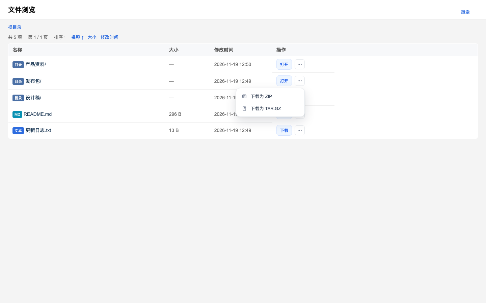
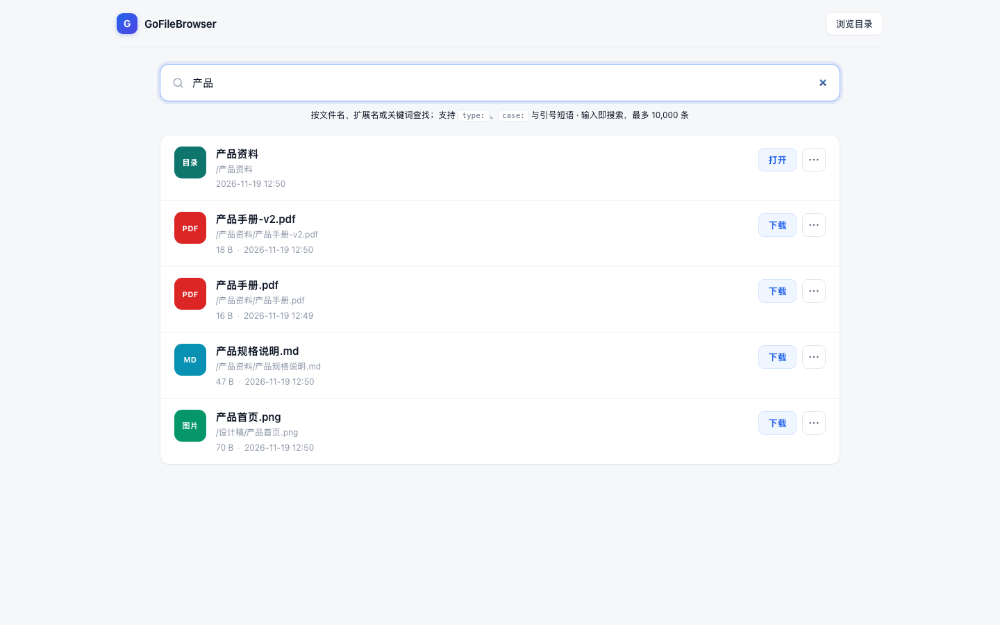
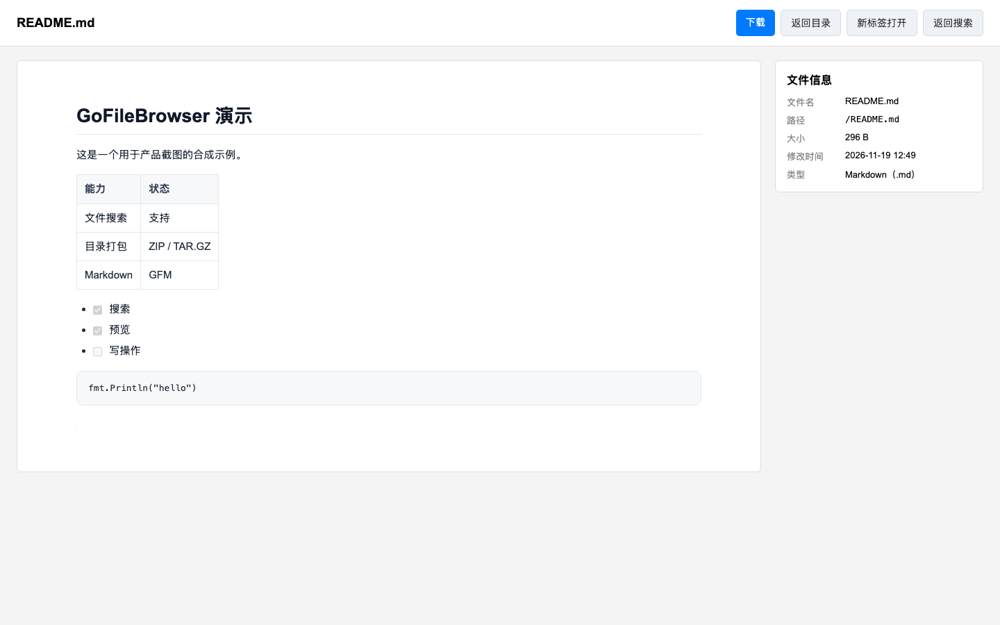

# GoFileBrowser Binaries

GoFileBrowser 的免费二进制发布页。

> **源码仓库为私有，本仓库不包含源码。**
> 本仓库不是开源仓库，只提供免费二进制分发。

## 下载

- 打开 [Releases](https://github.com/szc3h9/GoFileBrowser-Binaries/releases)
- 下载对应架构的 `.tar.gz` 和同名 `.sha256`
- 校验：

```bash
sha256sum -c GoFileBrowser-*.sha256
tar -xzf GoFileBrowser-*.tar.gz
```

当前支持：

- linux/amd64
- linux/arm64

## 界面预览

> 截图使用合成演示数据，不包含真实共享目录内容。

### 文件浏览与目录打包

点目录行的 `…`，可选择“下载为 ZIP / TAR.GZ”。



### 搜索

按文件名、目录名、扩展名搜索，结果带类型、路径、大小和时间。



### Markdown 预览

支持 CommonMark + GFM：表格、任务列表、代码块；服务端渲染并做 HTML 清洗。



## 当前版本

`v0.1.0-dev`

- linux/amd64：[下载](releases/v0.1.0-dev/GoFileBrowser-0.1.0-dev-df9ed54-linux-amd64.tar.gz) · [SHA256](releases/v0.1.0-dev/GoFileBrowser-0.1.0-dev-df9ed54-linux-amd64.tar.gz.sha256)
- linux/arm64：[下载](releases/v0.1.0-dev/GoFileBrowser-0.1.0-dev-df9ed54-linux-arm64.tar.gz) · [SHA256](releases/v0.1.0-dev/GoFileBrowser-0.1.0-dev-df9ed54-linux-arm64.tar.gz.sha256)

`Releases` 由 tag workflow 自动生成；如果暂时没有 Release，上面的原始文件链接也可直接下载。

## 文档

- [用户指南](USER_GUIDE.md)
- 包内 `README.md` 也是同一份用户指南

## 许可

- 项目：[Apache License 2.0](LICENSE)
- 项目声明：[NOTICE](NOTICE)
- 第三方组件：[THIRD_PARTY_LICENSES.md](THIRD_PARTY_LICENSES.md)
- 许可文本：`third_party/licenses/`

二进制包内同样包含以上许可文件。再分发时请保留这些声明。

## 说明

- 源码不在此仓库；
- 不提供源码下载；
- 不在此仓库接收源码 PR；
- 使用问题请通过二进制包内用户指南排查。
